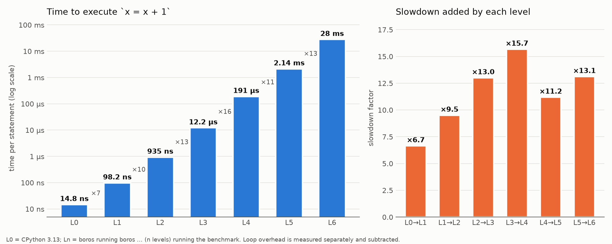

# boros

`boros` is a python interpreter written in python. The general idea was to compare the execution time of some statement at the following levels:

- L0: The execution time of the statement when executed by the python interpreter.
- L1: The statement when executed by boros (which is being interpreted by the python interpreter).
- L2: The statement when executed by boros, when interpreted by boros, which is being interpreted by the python interpreter.
- L3: The statement when executed by boros, when interpreted by a boros that is being interpreted by boros, which is interpreted by the... you get the idea.
- L4: etc etc etc

This isn't particularly scientific, because a large number of arbitrary design decisions would radically change the results, it just seemed like a neat experiment to hand off to claude - plus one gets a cool interpreter which can be mined for insight on interpreter design if (like me) you're a noob when it comes to interpreters.

## Results



## More Info

If you prefer to read the README by claude, which has more information, but is written in excessively verbose claudish, that is at [README.claude.md](./README.claude.md). I don't have the will or time to rewrite what it wrote in a way that is easier, clearer, or less aggravating to read, but didn't want to delete that info outright.

## Prompts

```
Can you write a python interpreter in python that can run itself? Don't use the eval or exec function, actually create the interpreter. I'm going out for dinner and so you can cook while I'm gone. Make sure to add tests for it and don't stop until you've written it and run it in itself. Specifically I'm curious how much slower it gets for each level of running itself in itself. Try not to use hacks, and actually fully implement the interpreter in python. I'm hoping for a graph that shows how long a simple statement takes to execute for each level of recursive self-running (L0 - just the normal python interpreter, L1 - the python interpreter you wrote running the program, L2 - the python interpreter you wrote running itself running the program, etc). Don't stop until you've finished.
```

```
Great. Got back from dinner. I added ruff, pyright, and pyinstrument to the dev dependencies. Can you:

1. Run ruff check --fix
2. Fix all non-auto-fixable ruff errors.
3. Go through your work and ensure that all parameters and variables have type annotations.
4. Run pyright on the project and fix all type errors, *without* supressing via # type: ignore.
5. Factor out the single module you created into isolated and readable modules with functionality appropriately grouped.
6. Reduce the cyclomatic complexity of each function so I can read the code to better understand the internals of the python interpreter.
7. Rerun ruff and pyright and ensure that everything still works.
8. Add docstrings to all significant functions for clarity.
9. Add an ## Explanation section to the README that has a comprehensive explanation of how the python interpreter you implemented works.
```